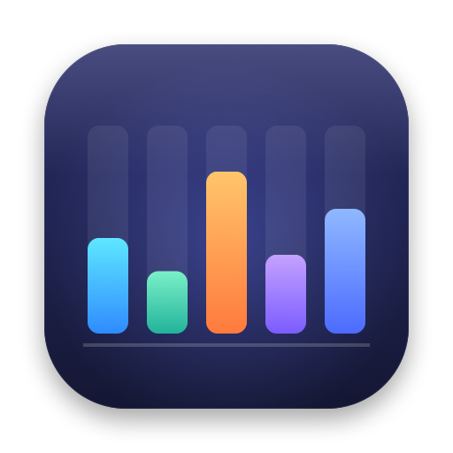
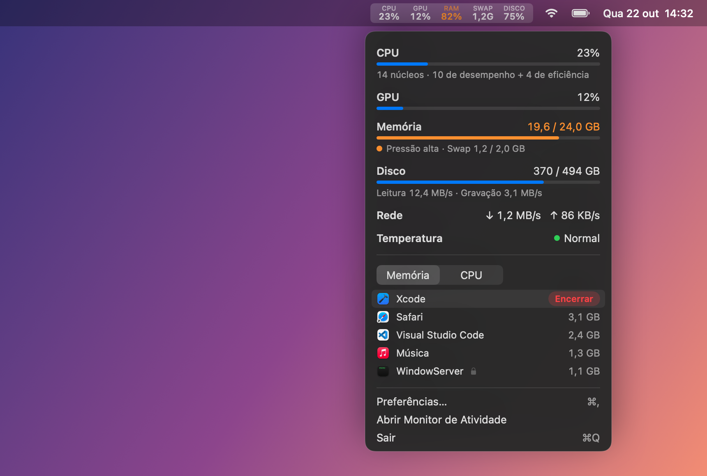
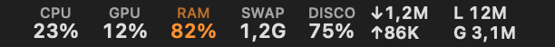
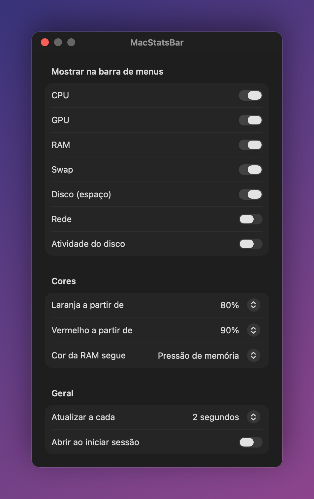

<p align="center">
  
</p>

<h1 align="center">MacStatsBar</h1>

<p align="center">
  CPU, GPU, RAM, swap, disco, rede e temperatura do seu Mac, direto na barra de menus.
</p>

<p align="center">
  <a href="https://github.com/felipereisdev/mac-stats-bar/releases/latest"></a>
  
  
  
  <a href="LICENSE"></a>
</p>

<p align="center">
  
</p>

## Recursos

- **Barra de menus compacta:** cada métrica tem um rótulo pequeno em cima e o número embaixo. As colunas têm largura fixa, então nada "pula" quando os valores mudam.
- **Cores que avisam:** o número fica laranja e depois vermelho quando passa dos limites que você define. A RAM segue a **pressão de memória** do macOS (o mesmo indicador do Monitor de Atividade), e não a porcentagem usada, que vive alta no macOS e engana.
- **Menu detalhado:** mostra GB usados de quantos, swap, núcleos de desempenho e de eficiência, leitura e gravação do disco, download e upload da rede e o estado térmico.
- **Apps que mais consomem:** os 5 que mais usam memória ou CPU, com os processos auxiliares somados ao app (todo o Chrome aparece numa linha só).
- **Encerrar pelo menu:** passe o mouse sobre um app e clique em **Encerrar**. Uma confirmação mostra quanto de RAM vai ser liberado. Processos do sistema aparecem com 🔒 e não podem ser encerrados.
- **Termômetro discreto:** um 🌡 só aparece na barra quando o Mac esquenta a ponto de reduzir o desempenho.
- **Leve:** cerca de 0,5% de CPU quando parado. A lista de processos só é coletada enquanto o menu está aberto.
- **Privado:** nada sai do seu Mac. O app não acessa a rede nem coleta dados de uso.

<p align="center">
  <br>
  <sub>Todas as colunas ligadas, incluindo as opcionais de rede (↓/↑) e de atividade do disco (L/G).</sub>
</p>

## Preferências

Abra pelo menu em **Preferências…** (⌘,). Lá você escolhe:

- quais colunas aparecem na barra;
- a partir de que porcentagem o número fica laranja e vermelho;
- se a cor da RAM segue a pressão de memória ou a porcentagem usada;
- o intervalo de atualização (1, 2 ou 5 segundos);
- se o app abre ao iniciar sessão.

<p align="center">
  
</p>

## Instalação

1. Baixe o `MacStatsBar-x.y.z.zip` da [página de releases](https://github.com/felipereisdev/mac-stats-bar/releases/latest).
2. Descompacte e arraste o **MacStatsBar.app** para a pasta **Aplicativos**.
3. Abra o app. Ele aparece na barra de menus, sem ícone no Dock.

> [!NOTE]
> O app tem assinatura ad-hoc e não é notarizado pela Apple, então na primeira abertura o macOS avisa que não pode verificar o desenvolvedor. Para liberar, vá em **Ajustes do Sistema › Privacidade e Segurança** e clique em **Abrir Mesmo Assim**. Outra opção é rodar no Terminal:
>
> ```bash
> xattr -dr com.apple.quarantine /Applications/MacStatsBar.app
> ```

Para tirar o app do início de sessão, use as Preferências ou **Ajustes do Sistema › Geral › Itens de Início**.

## Compilar a partir do código

Você precisa do Swift 5.9 ou mais novo. As Command Line Tools bastam (`xcode-select --install`), não é preciso ter o Xcode.

```bash
git clone https://github.com/felipereisdev/mac-stats-bar.git
cd mac-stats-bar
./install.sh            # compila, instala em /Applications e abre o app
```

Outros scripts:

| Comando | O que faz |
| --- | --- |
| `Scripts/build-app.sh` | Monta `build/MacStatsBar.app` (com `--universal`, para arm64 e x86_64) |
| `Scripts/package.sh` | Gera o `.zip` universal usado nas releases |
| `swift Scripts/make-icon.swift` | Redesenha o ícone (`Resources/AppIcon.icns` e `docs/icon.png`) |

## De onde vêm os números

Todos os valores vêm de APIs públicas do macOS e não exigem senha de administrador. Cada um foi conferido com a ferramenta de referência indicada.

| Métrica | Fonte | Referência |
| --- | --- | --- |
| CPU | `host_statistics` (`HOST_CPU_LOAD_INFO`), diferença entre duas leituras | `iostat` (us + sy) |
| GPU | `IOAccelerator` › `PerformanceStatistics` › `Device Utilization %` (valor instantâneo) | `ioreg` |
| Memória | Fórmula do Monitor de Atividade: memória dos apps + fixa + comprimida (`host_statistics64`) | `vm_stat` |
| Pressão de memória | `kern.memorystatus_vm_pressure_level` | `memory_pressure` |
| Swap | `vm.swapusage` | `sysctl vm.swapusage` |
| Disco (espaço) | Capacidade disponível "para uso importante", a mesma que o Finder mostra | Finder |
| Disco (atividade) | `IOBlockStorageDriver` › `Statistics` | `iostat` |
| Rede | Contadores das interfaces físicas (`en*`) via `NET_RT_IFLIST2` | `netstat -ib` |
| Temperatura | `ProcessInfo.thermalState` | `pmset -g therm` |
| Processos | `top` (memória como no Monitor de Atividade e %CPU), agrupados pelo app | Monitor de Atividade |

Algumas observações:

- **Espaço em disco:** o espaço que o macOS pode liberar sozinho, como caches e snapshots locais, conta como livre, igual ao Finder. Por isso o valor "usado" pode ser menor que o do `df` ou do `diskutil`.
- **Rede:** VPNs e redes virtuais de VMs e containers ficam de fora, para o mesmo tráfego não ser contado duas vezes. Os contadores das interfaces têm 32 bits para apps sem privilégios, então o app trata a volta que acontece a cada 4 GB.
- **CPU por app:** é contada por núcleo, como no Monitor de Atividade, então um app pode passar de 100%.
- **Temperatura:** o macOS não oferece leitura em graus sem acesso privilegiado. O app mostra o estado térmico que o sistema informa (Normal, Elevada, Alta ou Crítica).

## Estrutura

```
Sources/MacStatsBar/
├── main.swift            # AppDelegate: item da barra, menu, timer, encerrar apps, Preferências
├── SystemSampler.swift   # Coleta de CPU, GPU, memória, swap, disco, rede e temperatura
├── TopSampler.swift      # Processos via `top`, agrupados por app
├── StatsModel.swift      # Estado observável, níveis de alerta e formatação pt-BR
├── Settings.swift        # Preferências (UserDefaults) e abertura ao iniciar sessão
└── Views.swift           # SwiftUI: barra, menu, skeleton e Preferências
```

## Licença

[MIT](LICENSE) © Felipe Reis
